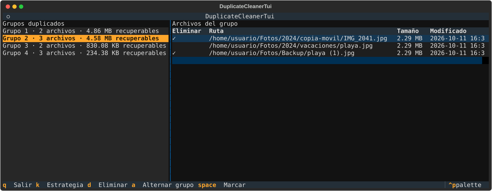

# Duplicate Cleaner

Aplicación multiplataforma para **detectar y limpiar archivos duplicados** en equipos Windows y Linux.

Compara por tamaño y hash y agrupa los duplicados. Por defecto solo simula (para borrar hay que pedir `--apply`), y las interfaces gráfica y de terminal piden confirmación antes de eliminar. Tiene tres interfaces sobre el mismo motor: CLI, interfaz gráfica (PySide6) y TUI para trabajar por SSH en servidores sin escritorio.



## Características (v0.3)

- Escaneo recursivo de uno o varios directorios
- Detección por tamaño + hash (`sha256` por defecto)
- **Interfaz gráfica (PySide6)** para revisar duplicados y eliminar con confirmación
- **TUI interactiva (Textual)** para sesiones SSH sin escritorio
- **Informe reutilizable** (`scan --save` / `clean-report`) para SSH y auditoría
- Informe en tabla o JSON (CLI)
- Limpieza con simulación (`--dry-run`) y estrategias de conservación
- Exclusiones por defecto según sistema operativo
- CLI usable desde terminal en ambos sistemas

## Requisitos

- Python 3.10 o superior
- Windows 10+ o Linux (Debian, Ubuntu, etc.)

## Instalación

```bash
cd duplicate-cleaner
python -m venv .venv

# Linux/macOS
source .venv/bin/activate

# Windows (PowerShell)
.venv\Scripts\Activate.ps1

pip install -e ".[dev]"

# Con interfaz gráfica
pip install -e ".[gui,dev]"

# Con TUI (terminal interactiva, ideal SSH)
pip install -e ".[tui,dev]"
```

## Uso

### TUI interactiva (SSH / terminal)

```bash
duplicate-cleaner-tui /ruta/a/analizar
duplicate-cleaner tui ~/Descargas
duplicate-cleaner tui --report informe.json
ssh -t usuario@servidor 'duplicate-cleaner tui /datos/backups'
```

Atajos:

| Tecla | Acción |
|-------|--------|
| `↑`/`↓` | Navegar grupos y archivos |
| `Espacio` | Marcar/desmarcar archivo |
| `a` | Marcar/desmarcar todo el grupo |
| `k` | Cambiar estrategia (oldest → newest → first) |
| `d` | Eliminar marcados (confirmación) |
| `q` | Salir |

### Interfaz gráfica

```bash
duplicate-cleaner-gui
# o
duplicate-cleaner gui
python -m duplicate_cleaner.gui.app
```

Flujo recomendado:

1. Añade una o varias carpetas.
2. Pulsa **Escanear** y espera el progreso.
3. Revisa los grupos en el árbol (marca/desmarca archivos a eliminar).
4. Usa **Marcar duplicados** con la estrategia deseada.
5. Pulsa **Eliminar seleccionados** y confirma.

### Escanear duplicados (CLI)

```bash
duplicate-cleaner scan /ruta/a/analizar
duplicate-cleaner scan D:\Descargas E:\Backup --min-size 1024
duplicate-cleaner scan ~/Documentos --output json
```

### Informe reutilizable (SSH / auditoría)

Escanea una vez y prueba varias estrategias sin re-escanear:

```bash
# En el servidor (ideal con tmux para escaneos largos)
duplicate-cleaner scan /datos/backups --save informe.json

# Simular limpieza
duplicate-cleaner clean-report informe.json --keep oldest --dry-run

# Aplicar
duplicate-cleaner clean-report informe.json --keep oldest --apply
```

Flujo remoto con revisión local:

```bash
# Servidor
duplicate-cleaner scan /datos --save /tmp/dup.json

# Local
scp admin@servidor:/tmp/dup.json .

# Servidor (aplicar tras revisar)
duplicate-cleaner clean-report /tmp/dup.json --keep oldest --apply
```

### Limpiar duplicados (CLI, re-escanea)

```bash
duplicate-cleaner clean ~/Descargas --dry-run
duplicate-cleaner clean C:\Users\usuario\Downloads --keep newest --apply
```

Opciones útiles:

| Opción | Descripción |
|--------|-------------|
| `--min-size` | Ignora archivos más pequeños (bytes) |
| `--algorithm` | `sha256`, `md5` o `sha1` |
| `--save` | Guarda informe JSON reutilizable |
| `--exclude-name` | Omite carpetas por nombre |
| `--exclude-glob` | Omite rutas por patrón glob |
| `--keep` | `oldest`, `newest` o `first` al limpiar |
| `--dry-run` / `--apply` | Simular o borrar de verdad |

## Arquitectura

```
src/duplicate_cleaner/
├── cli.py           # Comandos scan, clean, clean-report, gui, tui
├── scanner.py       # Recorrido y agrupación de duplicados
├── hasher.py        # Cálculo de hash por bloques
├── config.py        # Opciones y exclusiones por SO
├── models.py        # Tipos de dominio
├── report_io.py     # Serialización de informes
├── reporting.py     # Salida y selección de archivos
├── gui/             # Interfaz PySide6
│   ├── app.py
│   ├── main_window.py
│   └── scan_worker.py
└── tui/             # Interfaz Textual (terminal)
    ├── app.py
    └── state.py
```

## Roadmap

- [x] Interfaz gráfica (PySide6)
- [x] Informe reutilizable (`scan --save` / `clean-report`)
- [x] TUI interactiva (Textual) para SSH
- [ ] Escaneo incremental con caché de hashes
- [ ] Empaquetado binario (PyInstaller / Nuitka)
- [ ] Soporte macOS

## Desarrollo

```bash
pytest
ruff check src tests
```

## Seguridad

- Usa siempre `--dry-run` antes de `--apply`
- Revisa los grupos duplicados manualmente en carpetas críticas
- Guarda informes (`--save`) antes de borrar en servidores remotos
- No escanees rutas de sistema completas sin exclusiones adicionales

## Licencia

[MIT](LICENSE) © 2026 Juan Antonio Francés Pérez
